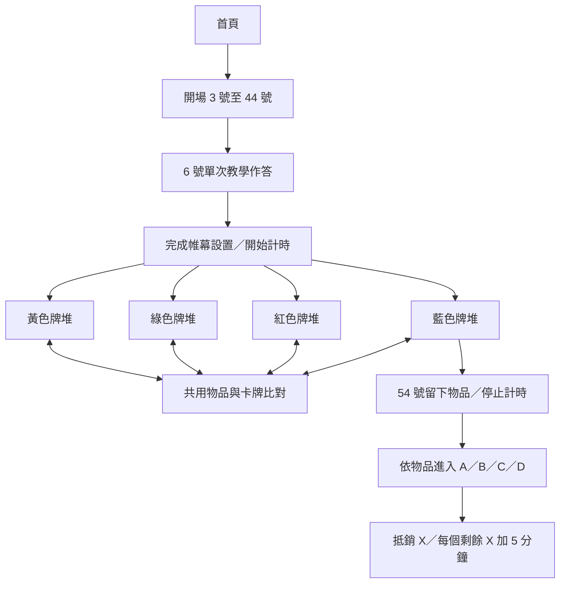

# 規則盤點與素材限制

盤點日期：2026-10-12。依據：使用者提供的 77 張 JPG、新版 15 號、一串鑰匙、34 號及 36 號 PNG 與使用者確認的答案。未從網路補入解答，也未將解謎推測寫成正式答案。

## 可直接確認的規則

| 規則 | 證據 | 實作 |
|---|---|---|
| 每題僅一次解答機會 | 開場 `004-遊戲簡介.jpg` | 送出前確認，送出後鎖定答案 |
| 錯誤記一個 X，仍依卡牌指示繼續 | 開場 `008-題目1提示.jpg` | 不要求重新答到正確才前進 |
| 缺少必需物品嘗試解題，雙倍懲罰 | 開場 `004-遊戲簡介.jpg` | 確認依賴不足或人工核對缺件，該題記 2 X |
| 物品保留，可能重複使用 | 開場 `004-遊戲簡介.jpg` | 道具跨牌堆共用，不任意消耗 |
| 四堆獨立，僅看各堆頂端 | 開場 `011-遊戲正式開始.jpg` | 四個游標，開放自由切換 |
| 44 號設置完畢，記錄起始時間 | 開場 `016-藍色帷幕.jpg` | 教學不計時，44 號後啟動 |
| 手電筒有電池才翻面 | 藍色 `003-不能用的手電筒.jpg` | 檢視與比對都檢查電池 |
| 8、9 號卡背為提示卡，從開場即可查看 | 使用者確認；開場 `012-關卡提示.jpg` | 提示區常駐兩張原卡；單題提示另記錄使用次數，不自行扣分 |
| 結局選擇留下物品 | 藍色 `013-結局選擇.jpg` | 僅能選擇已取得的物品，提交前確認 |
| 每個 X 加 5 分鐘 | 四張結局圖 | 實際時間加剩餘 X × 5 分鐘 |
| A/B/C/D 抵銷 2/0/1/3 個 X | 四張結局圖 | 先抵銷、再加時，X 最低為 0 |
| 0–60、61–90、91 分鐘以上三個評級 | 四張結局圖 | 依分鐘欄位捨去秒數後比對，秒數仍顯示 |

## 九題自動核對的來源

以下含解答，供製作者核對，不出現在尚未作答的玩家畫面。

| 卡號 | 已確認答案 | 原文來源 |
|---|---|---|
| 6 | 紫色按鈕 | 開場 `008-題目1提示.jpg` 是「解決方案」背面 |
| 12 | 計算器上的 X／乘號 | 黃色 `002-001通關.jpg`，13 號敘事明確說明 |
| 14 | 6 | 使用者明確確認 |
| 15 | C3 或 3C，忽略標點與空白 | 使用者明確確認；圖片改用 `005-箭頭方向-題目3_改.png` |
| 23 | A | 使用者明確確認；鑰匙物品圖改用 `007-一串鑰匙-物品2_改.png` |
| 24 | Einstein／愛因斯坦 | 綠色 `003-002通關.jpg`，25 號敘事明確說明 |
| 31 | 第三把鎖 | 綠色 `011-010通關.jpg`，32 號敘事明確說明 |
| 34 | 2D 或 D2 | 使用者明確確認；圖片改用 `001-正確方塊-題目1_改.png` |
| 36 | H | 使用者明確確認；圖片改用 `004-找出膠囊-題目2_改.png` |

12、24、31 號的謎題背面仍缺少；只利用下一張原文中無歧義的動作或答案，不把下一張敘事圖錯標為解答背面。

## 待補的 17 題原版解答

| 牌堆 | 卡號與題目 |
|---|---|
| 黃色 | 17 工具箱、19 工具箱裡面、20 另一塊電路板 |
| 綠色 | 26 四台顯示器、27 無法關閉的顯示器、28 照向牆的光線、30 行李箱的鑰匙 |
| 紅色 | 38 寶箱、40 四個燒瓶、42 損壞的電路板 |
| 藍色 | 45 博士的書架、46 秘密控制閘、48 機械門、49 鎖上的門、50 尋找座標、52 另一扇機械門、53 出發 |

人工核對會保留答案、作答时间、核對狀態與懲罰。沒有實體解答時可以明確選「待核對」往後探索；這是讓缺件原型可走通的便利措施，不等於原版正式核對。結算標為暫定下限，可事後補核對。

## 必需物品的資料範圍

目前自動缺件檢查只採卡面明確寫出／直接要求的物品：

| 卡號 | 物品 | 卡面依據 |
|---|---|---|
| 20 | 電路板 | 找到電路板缺少的部分 |
| 23 | 一串鑰匙 | 找正確的鑰匙打開衣櫃 |
| 26 | 手電筒＋電池 | 按照手電筒提示，手電筒背面另要求電池 |
| 40 | 膠囊 | 將膠囊投入燒瓶 |
| 46 | 電子卡 | 依箭頭方向插入電子卡 |
| 48 | 光盤 | 必須插入光盤 |
| 52 | 藍色電極 | 隨身帶著電極，決定插入位置 |

例如密碼條與 24 號、便條與抽屜等相互關係，現有解答背面不足以完整確認原版的缺件扣分判準，不擅自加入自動懲罰。人工核對可勾選當時缺少其他必需物品。

## 數位化處理與待核定事項

- 1、2 號原版卡未能從現有照片確認完整正反面編號；不建立虛構圖片。開場由所提供的 3 號開始。使用者已確認 8、9 號卡背為提示卡；以 `012-關卡提示.jpg` 左、右圖分別顯示於提示區，從開場即提供，不需要重新開始舊存檔。
- 綠色資料夾有兩張檔名前綴 `006`，分別是 27、28 號。藍色檔名 `002-001通關` 實際仍是 46 號新謎題。全部使用明確資料順序，不依檔名字串排序決定流程。
- 原版未提供暫停規則，因此正式開始後持續計時；讀取開始時間與現在時間的差值，涵蓋背景分頁與瀏覽器關閉期間。
- 最後確認留下物品時停止計時，以免把閱讀結局和核對成績的時間納入。原圖只要求結束時記時，沒有秒級精確定義。
- 評級邊界原图使用整數分鐘，未說明秒數舍入；此版本配合得分表「小時：分鐘」欄位捨去秒數。若原說明書另有規定，可在 `GameEngine.stats` 調整。
- 已看過的卡片保留於「已讀卡牌」以方便本機回顧。51 號背面明示棄置，正常牌堆會往後移除；歷史檢視仍保留圖片，屬數位便利處理。
- 提示區可直接查看 8、9 號完整卡背並放大、旋轉；查閱原卡不另增加單題提示次數。另保留依題目卡號顯示原版圖片單列的入口。共兩欄 26 列；55 號提示在最後選擇時提供。提示卡不算結局可留下的物品。
- 圖片旋轉與比對僅用 CSS／畫布顯示，不修改原始 JPG。重疊提供位置、角度、透明度及比例調整。
- 9 個自動核對答案是有限格式判定；英文不分大小寫，全半形一致化。依使用者更新的偏好，15、34 號座標忽略空白、Unicode 標點與符號，因此 `C,3`、`C3。`、`C 3`、`D,2` 及全形寫法均可判定正確；原始輸入仍保留。字母與數字必須相符，混入另一個座標或多餘字母數字仍判錯。中文乘號動作納入常見表述，仍可能不涵蓋所有自由語句。
- 讀取舊存檔時，若未核對作答已有新確認答案，會用原始作答自動判定並更新錯誤紀錄與懲罰。已核對紀錄、原始答案、時間與牌堆進度均保留。
- 「待核對」結果不是正確答案，不能用它宣稱全部原版規則已通過驗證。

## 流程

